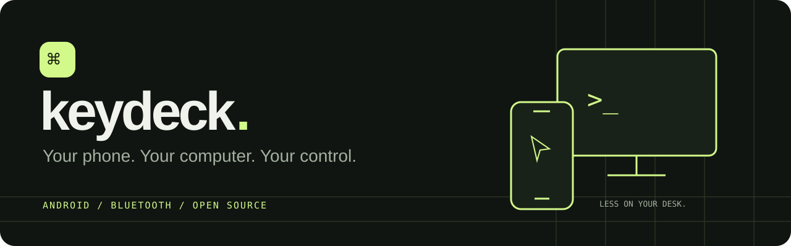

<p align="center"></p>

<p align="center">
  <a href="https://github.com/abhieee-java/keydeck/actions/workflows/ci.yml"></a>
  <a href="https://github.com/abhieee-java/keydeck/actions/workflows/android.yml"></a>
  <a href="LICENSE"></a>
  
</p>

<p align="center"><b>A Bluetooth keyboard and mouse that fits in your pocket.</b><br />Turn an Android phone into a touchpad, keyboard, and command input device for your computer.</p>

<p align="center"><a href="https://github.com/abhieee-java/keydeck/releases"><b>↓ APK releases</b></a> · <a href="docs/INSTALL.md">Install & pair</a> · <a href="#what-you-can-do">Features</a> · <a href="CONTRIBUTING.md">Contribute</a></p>

> **Early preview.** The first signed APK is being prepared. Source and browser-preview tests are available; physical Bluetooth compatibility is not yet certified. Only install an APK attached to a release—GitHub's “Source code” downloads are not apps.

## From download to control

1. On your phone, open **[Releases](https://github.com/abhieee-java/keydeck/releases)** and select a release with an APK attachment.
2. Download **`keydeck-vX.Y.Z.apk`**, open it, and allow installation from your browser when Android asks.
3. Open Keydeck, allow **Nearby devices**, and choose **Connect device → Make discoverable**.
4. Add the phone from your computer's Bluetooth settings. Return to Keydeck, refresh the device list, and connect.

No account, subscription, desktop agent, or shared Wi-Fi network is needed for keyboard and mouse input. Initial pairing requires access to the computer's Bluetooth settings. Keep Keydeck open while controlling it.

**[Full installation guide →](docs/INSTALL.md)**

## What you can do

| Control | Included in the foundation |
| --- | --- |
| **Touchpad** | Move, tap to click, two-finger scroll, left/right click, drag toggle, direction buttons |
| **Keyboard** | Send text, use navigation/function keys, compose Ctrl/Alt/Shift/Meta shortcuts |
| **Quick actions** | Copy, paste, switch apps, show desktop; Windows/macOS/Linux presets |
| **Command composer** | Type a command into the computer's focused terminal and press Enter |
| **Preview mode** | Explore the interface locally without sending Bluetooth input |

Keydeck uses Android's native **Bluetooth HID device** profile. The computer receives normal keyboard and mouse reports. The framework is React Native + Expo Router, with a small Kotlin module for Bluetooth.

## Know before you install

- **Android 9+** with Bluetooth HID device support. Some manufacturers disable this profile.
- The computer must accept Bluetooth keyboards and mice. Windows, macOS, and Linux are intended targets; see the [compatibility matrix](docs/COMPATIBILITY.md) for actual test status.
- Text input currently uses **US-layout ASCII**. Other layouts and Unicode input need additional work.
- **Command input is not a remote shell.** Keydeck cannot read terminal output or show your computer screen over HID.
- This is foreground control, not a guaranteed replacement for input during initial pairing, boot/BIOS, or every protected OS dialog.

## Privacy by design

No backend, analytics, or account flow is implemented. Bluetooth input goes to the paired computer. Drafts, preferences, and command history currently live in memory and reset when the app process restarts. [Permissions and privacy →](docs/PRIVACY.md)

## Run the project

```sh
git clone https://github.com/abhieee-java/keydeck.git
cd keydeck
npm ci
npm run web       # local browser preview
npm run android   # Android SDK + connected device required
```

**Expo Go cannot provide Bluetooth HID.** Use a native build for real computer control. A standalone release APK includes the JavaScript bundle and does not need a development server.

```sh
npm run lint
npm run typecheck
npm test
npm run build:web
npx playwright install chromium
npm run test:ui
```

See [architecture](docs/ARCHITECTURE.md), [contributing](CONTRIBUTING.md), and [release signing](docs/RELEASING.md).

## What's next

- [ ] Verify Bluetooth behavior across real phones and host operating systems
- [ ] Improve the phone-first interface and accessibility with device testing
- [ ] Add keyboard layouts and persisted preferences
- [ ] Design an authenticated desktop companion for terminal output and screen features

Found a device that works—or a reproducible problem? [Open a report](https://github.com/abhieee-java/keydeck/issues/new/choose) with your phone, Android version, and computer OS. A star helps other people discover the project.

## License

[MIT](LICENSE). Built on Expo and React Native. Third-party projects retain their own licenses.
